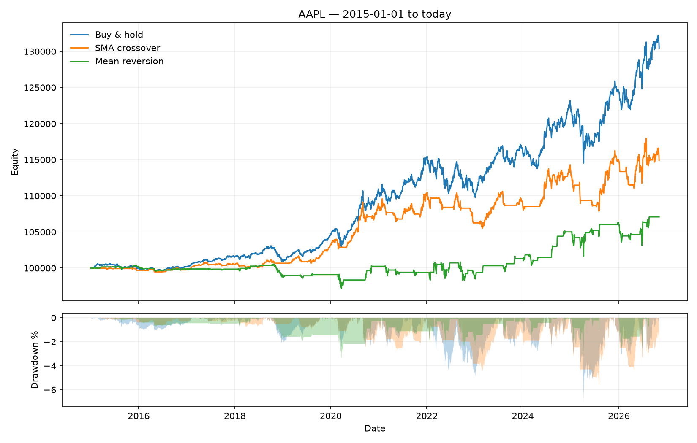

# backtest-engine

Event-driven backtesting engine for daily equity strategies. Written to be read:
each component has one responsibility, and the event loop makes look-ahead bias
structurally impossible rather than merely discouraged.


## Why this exists

Most backtests quietly fill orders at the very price that generated the signal,
which inflates every result that follows. Here a signal produced on bar *t* can
only be filled at the open of bar *t+1*, and `tests/test_no_lookahead.py` fails
if that ever stops being true.

## Design

| Component | Responsibility |
|---|---|
| `DataFeed` | Abstract source of bars |
| `FrameFeed` | Shared base for sources backed by a pandas frame; validates columns, streams in order |
| `CSVFeed` / `StooqFeed` | From disk / downloaded over HTTP from stooq.com, with an on-disk cache |
| `Strategy` | Sees a closed bar, returns orders. `SMACrossover`, `MeanReversion`, `BuyAndHold` |
| `Broker` | Turns orders into fills, applying slippage and commission |
| `Portfolio` | Positions, cash, equity curve |
| `Backtester` | The event loop connecting them |

Patterns used deliberately: **Strategy** (trading logic), **Template Method**
(`Strategy.handle` wraps `on_bar`), **Factory** (`make_feed`), **Dependency
Injection** (broker and portfolio are passed in, not constructed inside the engine).

A detail worth naming: both sources signal failure while returning HTTP 200 — stooq
with a line of plain text, Yahoo with an error object inside otherwise valid JSON.
Both parsers check the payload rather than the status code, so a refused download
fails loudly instead of silently producing an empty backtest.

## Install

```bash
git clone https://github.com/wojratajczak/backtest-engine.git
cd backtest-engine
python -m venv .venv && .venv\Scripts\activate
pip install -e ".[dev]"
pytest
```

## Run

```bash
python main.py --symbol AAPL --start 2015-01-01 --fast 20 --slow 50
```

Two web sources are supported: `--source yahoo` (default, `AAPL`, `PKN.WA`) and
`--source stooq` (`aapl.us`, `pkn`). Downloads are cached under `data/`, so repeated
runs do not hit the server.

```
strategy                 final    return   sharpe   max DD
--------------------------------------------------------
Buy & hold             130,482     30.5%     0.67    -7.0%
SMA crossover          114,917     14.9%     0.45    -5.6%
Mean reversion         107,089      7.1%     0.26    -3.3%
```

## Library use

```python
from btengine import Backtester, Portfolio
from btengine.data import YahooFeed
from btengine.metrics import max_drawdown, sharpe
from btengine.strategy import SMACrossover

feed = YahooFeed.download("AAPL", start="2015-01-01", cache_dir="data")
result = Backtester(feed, SMACrossover(fast=20, slow=50), Portfolio(100_000)).run()

print(f"Sharpe: {sharpe(result.equity_curve):.2f}")
print(f"Max drawdown: {max_drawdown(result.equity_curve):.1%}")
```

## Results

`python main.py --symbol AAPL --start 2015-01-01`

AAPL, January 2015 to date. Starting cash 100,000, a fixed 100-share position per
trade, 1 bp slippage and 0.5 bp commission, every fill at the next bar's open.

| Strategy | Final equity | Return | Sharpe | Max drawdown |
|---|---:|---:|---:|---:|
| Buy & hold | 130,482 | 30.5% | 0.67 | -7.0% |
| SMA crossover (20/50) | 114,917 | 14.9% | 0.45 | -5.6% |
| Mean reversion (z < -1.5) | 107,089 | 7.1% | 0.26 | -3.3% |



Both strategies underperform buy-and-hold on this sample, at roughly half its
drawdown. That is the expected outcome and it is reported rather than tuned away:
the deliverable here is the engine, and an engine that flatters its strategies is
worthless.

One thing these figures are not: a statement about AAPL. Position size is a fixed
100 shares against 100,000 of cash, so most of the portfolio sits idle and the
returns are far below a fully invested position. The numbers compare three
strategies under identical conditions — nothing more.

## Limitations

- Daily bars only: no intraday, no partial fills, no market impact beyond fixed slippage
- Single-asset portfolios in the current version
- Slippage is a flat spread in basis points, not a function of traded volume
- Position sizing is a fixed share count, not a function of volatility or equity

## Roadmap

- [ ] Multi-asset portfolios and position sizing
- [ ] Walk-forward parameter selection
- [ ] Streamlit app for interactive parameter exploration
